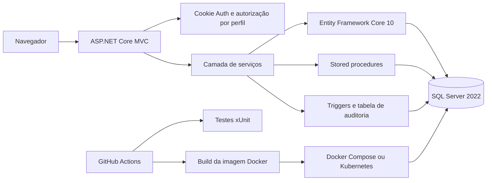
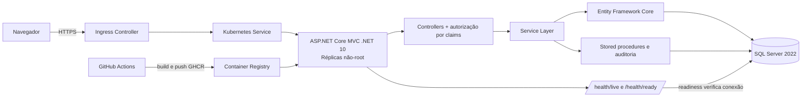

# AlunosTech.NewSistem

[](https://github.com/GregooMr/AlunosTech_NewSistem/actions/workflows/ci.yml)

Plataforma web acadêmica para apoiar a gestão de cursos, matrículas, conteúdos, avaliações e comunicação entre alunos e professores. O projeto demonstra uma aplicação em camadas com autenticação por cookies, persistência em SQL Server, testes automatizados e execução conteinerizada.

> **Tecnologia web:** o projeto usa ASP.NET Core MVC (`Controllers` + `Views` Razor), não Razor Pages nem Blazor.

## Visão geral

O AlunosTech oferece fluxos distintos para alunos e professores. Alunos consultam cursos e conteúdos, acompanham o progresso, realizam provas e acessam certificados; professores gerenciam conteúdos e respondem dúvidas no fórum. Os dados são persistidos no SQL Server, com regras de aplicação organizadas em serviços.

### Funcionalidades

- Autenticação de alunos e professores com autorização por perfil.
- Cadastro de aluno com matrícula em curso.
- Catálogo de cursos, conteúdos didáticos e acompanhamento de progresso.
- Realização de prova e emissão de certificado conforme as regras do sistema.
- Gestão de conteúdos na área do professor e fórum de dúvidas.
- Auditoria de alterações relevantes de matrícula e nota.
- Seed de demonstração e endpoints de saúde para execução e orquestração.

## Tecnologias

Versões verificadas nos arquivos do repositório. O projeto não fixa uma versão de patch do SDK com `global.json`; requer SDK compatível com .NET 10.

| Tecnologia | Versão/configuração |
| --- | --- |
| C# / .NET / ASP.NET Core | .NET 10 (`net10.0`) |
| Entity Framework Core SQL Server / Tools | `10.0.15` |
| SQL Server | 2022 (imagem Docker `2022-latest`) |
| xUnit | `2.9.3` |
| Microsoft.NET.Test.Sdk | `17.14.1` |
| EF Core InMemory (testes) | `10.0.15` |
| Bootstrap | `5.3.3` (arquivos estáticos locais em `wwwroot/lib`) |
| jQuery | `3.7.1` (arquivos estáticos locais em `wwwroot/lib`) |
| Contêineres | Dockerfile multi-stage; Docker Compose V2 (versão do Docker não fixada no repositório) |
| CI | GitHub Actions; publicação GHCR em push para `main` |

## Arquitetura

A solução segue MVC com uma camada de serviços: controllers tratam requisições e autorização; serviços concentram regras de aplicação; Entity Framework Core acessa o SQL Server. O script SQL provisiona também procedures e triggers usadas nos fluxos acadêmicos e de auditoria.



Não é Clean Architecture: trata-se da aplicação MVC existente organizada com serviços, persistência e interface web.

## Requisitos

Para executar localmente:

1. Windows, Linux ou macOS compatível com o .NET 10.
2. .NET 10 SDK.
3. SQL Server 2022 ou superior, SQL Server Express/Developer ou SQL Server no Docker.
4. Ferramenta para executar SQL, como SQL Server Management Studio, Azure Data Studio ou `sqlcmd`.
5. Visual Studio Community 2026 18.10.3 ou outro editor compatível, opcionalmente.

Para executar com Docker:

1. Docker Desktop em execução.
2. Pelo menos 4 GB de memória disponíveis para o SQL Server; 6 GB ou mais é recomendado.
3. Porta `8080` livre. A porta SQL `1433` não é publicada no host por padrão.

## Pacotes NuGet

O projeto declara os seguintes pacotes em `AlunosTech.NewSistem/AlunosTech.NewSistem.csproj`:

- `Microsoft.EntityFrameworkCore.SqlServer` `10.0.15`: provider do EF Core para SQL Server.
- `Microsoft.EntityFrameworkCore.Tools` `10.0.15`: ferramentas de desenvolvimento do EF Core, com `PrivateAssets=all`.

O restante vem do SDK Web compartilhado do .NET.

## Banco de dados

O script oficial é:

```text
database/AlunosTech_Moderno.sql
```

Ele é o único script canônico do banco e pode ser executado em um banco novo ou novamente em uma base existente. Ele contém:

- criação das seis tabelas usadas pelo modelo;
- chaves estrangeiras, constraints e índices;
- correções de compatibilidade de bases antigas;
- função de aprovação;
- procedure de conclusão de prova e emissão de certificado;
- trigger de auditoria;
- dados de demonstração idempotentes.

O script não apaga tabelas nem dados. Ele exige execução em modo SQLCMD e uma senha `APP_DB_PASSWORD` forte (mínimo 8 caracteres, conforme política SQL Server). Se uma base antiga possuir matrículas duplicadas, o índice único poderá exigir correção manual antes da execução.

### Executar pelo SSMS ou Azure Data Studio

1. Inicie o SQL Server.
2. Abra `database/AlunosTech_Moderno.sql`.
3. Conecte-se com um usuário que possa criar banco, login, usuários e objetos do banco.
4. Habilite **SQLCMD Mode** (SSMS: menu **Query > SQLCMD Mode**) e, no início da janela de consulta, defina `:setvar APP_DB_PASSWORD "SUA_SENHA_FORTE"` com a mesma senha de `app_user`; no Azure Data Studio, use a extensão SQLCMD.
5. Confirme se o banco `AlunosTech_Moderno` foi criado.

### Executar pelo sqlcmd

Exemplo para SQL Server local com autenticação SQL:

```powershell
$env:MSSQL_SA_PASSWORD = "__DEFINA_A_SENHA_SA__"
$env:APP_DB_PASSWORD = "__DEFINA_A_SENHA_APP_USER__"
sqlcmd -S localhost,1433 -U sa -P $env:MSSQL_SA_PASSWORD -v APP_DB_PASSWORD="$env:APP_DB_PASSWORD" -C -b -i .\database\AlunosTech_Moderno.sql
```

Ao executar o script, informe também `APP_DB_PASSWORD` via `sqlcmd -v` para criar/atualizar o login de aplicação `app_user`. Não use senhas reais em comandos salvos em arquivos versionados.

## Configuração da conexão

A aplicação lê `ConnectionStrings:DefaultConnection`. `appsettings.json` contém somente um placeholder; configure a conexão fora dos arquivos versionados. O projeto tem `UserSecretsId` configurado para desenvolvimento local.

Para salvar a connection string nos User Secrets:

```powershell
dotnet user-secrets set "ConnectionStrings:DefaultConnection" "Server=localhost,1433;Database=AlunosTech_Moderno;User Id=app_user;Password=__SENHA_DO_APP_USER__;TrustServerCertificate=True;" --project .\AlunosTech.NewSistem\AlunosTech.NewSistem.csproj
```

Substitua o placeholder pela senha configurada para `app_user`. Em outros ambientes, use a variável `ConnectionStrings__DefaultConnection`, por exemplo:

```powershell
$env:ConnectionStrings__DefaultConnection = "Server=localhost,1433;Database=AlunosTech_Moderno;User Id=app_user;Password=__SENHA_DO_APP_USER__;TrustServerCertificate=True;"
```

Não grave senhas reais em `appsettings*.json` ou no controle de versão. Uma credencial de banco esteve anteriormente em `appsettings.json` e pode continuar no histórico Git; considere-a comprometida, troque-a no SQL Server e, se necessário, limpe o histórico conforme a política do repositório.

O `Program.cs` habilita `EnableRetryOnFailure()` para falhas transitórias de rede ou do SQL Server. O seed também não encerra a aplicação quando o banco está temporariamente indisponível; a ocorrência é registrada no log.

## Executar localmente

1. Clone ou abra o repositório.
2. Inicie SQL Server 2022 ou superior e habilite a porta `1433` no host para conexão local.
3. Configure User Secrets como descrito acima, com a connection string apontando para `localhost,1433`.
4. Execute `database/AlunosTech_Moderno.sql` em modo SQLCMD, informando `APP_DB_PASSWORD` com o mesmo valor da senha de `app_user` na connection string. Se usar SSMS, habilite **SQLCMD Mode** antes de executar o script.
5. Restaure e compile:

```powershell
dotnet restore .\AlunosTech.NewSistem\AlunosTech.NewSistem.csproj
dotnet build .\AlunosTech.NewSistem\AlunosTech.NewSistem.csproj
```

6. Inicie a aplicação:

```powershell
dotnet run --project .\AlunosTech.NewSistem\AlunosTech.NewSistem.csproj
```

7. Acesse `http://localhost:5185` (perfil HTTP) ou `https://localhost:7128` (perfil HTTPS). Para verificar a disponibilidade e o banco:

```powershell
Invoke-WebRequest http://localhost:5185/health/live
Invoke-WebRequest http://localhost:5185/health/ready
```

Se usar HTTPS com certificado de desenvolvimento confiável, substitua `5185` por `7128`.

## Usuários de demonstração

O seed cria os usuários abaixo. Em ambiente local/demonstração, a senha inicial é `123`; use essas contas apenas para avaliação local e troque/remova-as em qualquer ambiente compartilhado. O seed converte marcadores de demonstração em hashes quando aplicável.

| E-mail | Perfil |
| --- | --- |
| `lorandi@alunostech.com` | Professor |
| `mariana@alunostech.com` | Professor |
| `rafael@alunostech.com` | Professor |
| `camila@alunostech.com` | Professor |
| `carlos@alunostech.com` | Aluno |

Essas credenciais são somente para desenvolvimento. Altere ou remova os usuários antes de qualquer ambiente real.

## Executar no Docker Desktop

O arquivo `docker-compose.yml` sobe três serviços:

- `sqlserver`: SQL Server 2022 com volume persistente `sqlserver_data`;
- `db-init`: aplica o script SQL canônico e cria o login de aplicação com permissões mínimas;
- `app`: aplicação publicada pelo `Dockerfile`, exposta na porta `8080`.

A aplicação usa `Server=sqlserver,1433`, pois dentro da rede Compose o nome do serviço é o hostname do banco.

### Subir os serviços

Na raiz do repositório, crie o arquivo local de variáveis e substitua ambos os placeholders por senhas fortes e distintas:

```powershell
Copy-Item .env.example .env
notepad .env
docker compose up --build -d
```

No `.env`, defina senhas fortes e distintas para `MSSQL_SA_PASSWORD` e `APP_DB_PASSWORD` (mínimo 8 caracteres; use maiúsculas, minúsculas, números e símbolos). Em PowerShell, se o Compose não localizar o `.env`, informe-o explicitamente com `docker compose --env-file .env up --build -d`.

O `.env` é ignorado pelo Git. A porta `1433` não é publicada no host por padrão; descomente o mapeamento no Compose somente quando precisar administrar o SQL Server localmente.

Verifique os serviços:

```powershell
docker compose ps
docker compose logs -f app
```

Acesse:

- Aplicação: `http://localhost:8080`
- Health check: `http://localhost:8080/health`
- Liveness: `http://localhost:8080/health/live`
- Readiness (inclui SQL Server): `http://localhost:8080/health/ready`

O SQL Server pode levar alguns segundos para ficar pronto. O Compose aguarda o health check, executa `database/init-db.sh` pelo serviço `db-init` e só então inicia a aplicação. O script é executado pelo usuário administrativo do banco; a aplicação conecta como `app_user` sem privilégios DDL.

O Compose exige `MSSQL_SA_PASSWORD` e `APP_DB_PASSWORD` no `.env`; a aplicação conecta como `app_user`, não como `sa`.

Se o volume já tiver sido criado, alterar a variável não altera a senha existente. Para recriar o banco de desenvolvimento do zero, removendo os dados persistidos:

```powershell
docker compose down -v
docker compose up --build -d
```

O comando `down -v` é destrutivo para os dados do SQL Server.

Para atualizar a aplicação preservando o banco, use `docker compose up --build -d --force-recreate`; não acrescente `-v`. Se o serviço de inicialização falhar, consulte `docker compose logs db-init` antes de tentar novamente.

### Parar os serviços

```powershell
docker compose down
```

Para remover também os dados persistidos (operação destrutiva):

```powershell
docker compose down -v
```

## Testes automatizados

Execute toda a suíte com:

```powershell
dotnet test .\AlunosTech.NewSistem.slnx
```

Os testes de serviços usam EF Core InMemory para executar sem SQL Server. Eles cobrem regras de progresso, prova/certificado, autenticação e matrícula, mas não substituem a validação de procedures, índices ou constraints num SQL Server real.

No Visual Studio: abra `AlunosTech.NewSistem.slnx`, compile a solução, abra **Testar > Gerenciador de Testes** e escolha **Executar todos os testes**. O projeto de testes é `AlunosTech.NewSistem.Tests`.

## CI/CD

O workflow `.github/workflows/ci.yml` executa restore, build e testes em `push`/`pull_request` para `main`, constrói a imagem Docker e valida os manifests Kubernetes. Em push na `main`, publica `latest` e `sha-<commit>` no GHCR. O deploy automático está desativado; o job só poderá ser habilitado depois de configurar cluster e credenciais. A publicação GHCR ocorre em push para `main`, não em pull request.

## Arquitetura e fluxos

O MVC recebe as requisições HTTP; controllers aplicam autenticação/autorização e delegam regras a serviços. Os serviços usam EF Core para persistência e chamam procedures SQL onde necessário. O cookie de autenticação usa claims de usuário e perfil; o rate limiter limita tentativas de login. Em container, o Ingress encaminha para réplicas da aplicação, e cada réplica conecta ao SQL Server pela rede interna.



### Observabilidade

- `GET /health/live` verifica somente se o processo HTTP está ativo; não depende do banco.
- `GET /health/ready` verifica conexão com SQL Server e responde indisponível quando não consegue conectar.
- `GET /health` permanece como endpoint de compatibilidade e executa todos os health checks registrados.
- Os registros usam `ILogger` e os provedores padrão do ASP.NET Core. Falhas ao inicializar o seed são emitidas como warning e a aplicação continua inicializando.
- Em Kubernetes, startup/liveness usam `/health/live`; readiness usa `/health/ready` para retirar do tráfego uma réplica que perdeu acesso ao banco.

Logs estruturados distribuídos, tracing e métricas de negócio não estão configurados neste repositório; podem ser integrados a um backend de observabilidade escolhido para o ambiente.

## Kubernetes

Este diretório contém manifests-base de exemplo, não uma instalação pronta para qualquer cluster. Para produção, revise imagem, secrets, domínio/TLS, política de armazenamento e uso de banco gerenciado.

Os manifests ficam em `k8s/`. O arquivo `secret.example.yaml` contém somente placeholders e não é incluído no Kustomize. Crie os Secrets reais fora do repositório; `k8s/secret.yaml` está ignorado pelo Git.

No PowerShell, defina `MSSQL_SA_PASSWORD` e `APP_DB_PASSWORD` no ambiente, substitua a imagem de exemplo em `k8s/deployment.yaml` pela imagem publicada no GHCR e crie os secrets antes de aplicar os manifests:

```powershell
kubectl apply -f .\k8s\namespace.yaml
kubectl create secret generic alunostech-secrets -n alunostech --from-literal=ConnectionStrings__DefaultConnection="Server=sqlserver,1433;Database=AlunosTech_Moderno;User Id=app_user;Password=$env:APP_DB_PASSWORD;TrustServerCertificate=True;" --from-literal=MSSQL_SA_PASSWORD="$env:MSSQL_SA_PASSWORD" --from-literal=APP_DB_PASSWORD="$env:APP_DB_PASSWORD" --dry-run=client -o yaml | kubectl apply -f -
kubectl create secret tls alunostech-tls -n alunostech --cert .\cert.pem --key .\key.pem --dry-run=client -o yaml | kubectl apply -f -
kubectl apply -k .\k8s\
```

O Deployment usa `alunostech-web:latest` como nome de imagem de exemplo. Antes de aplicar, substitua esse valor em `k8s/deployment.yaml` por `ghcr.io/<owner>/alunostech-newsistem:latest`, com `<owner>` em minúsculas; para repositório privado, crie também um `imagePullSecret`. O Ingress requer um controller e certificado TLS; o HPA requer Metrics Server e o SQL Server requer uma StorageClass disponível.

O StatefulSet SQL é demonstrativo. Para provisionar o banco, use um computador com `sqlcmd` instalado e as variáveis `MSSQL_SA_PASSWORD` e `APP_DB_PASSWORD` definidas no PowerShell. O script do cluster referencia o Secret, que não é automaticamente repassado para variáveis do terminal:

```powershell
kubectl rollout status statefulset/sqlserver -n alunostech --timeout=5m
$sqlPod = kubectl get pod -n alunostech -l app=sqlserver -o jsonpath='{.items[0].metadata.name}'
kubectl port-forward -n alunostech "pod/$sqlPod" 11433:1433
```

Deixe o `port-forward` rodando e, em outro PowerShell na raiz do repositório, execute:

```powershell
sqlcmd -S localhost,11433 -U sa -P $env:MSSQL_SA_PASSWORD -C -b -v APP_DB_PASSWORD="$env:APP_DB_PASSWORD" -i .\database\AlunosTech_Moderno.sql
```

Depois que o SQL terminar com sucesso, encerre o `port-forward` com Ctrl+C e reinicie a aplicação para executar o seed:

```powershell
kubectl rollout restart deployment/alunostech-web -n alunostech
```

As duas PVCs da aplicação usam `ReadWriteMany`, portanto o cluster precisa de uma StorageClass/CSI compatível. Isso mantém uploads compartilhados entre réplicas e chaves de Data Protection estáveis para os cookies. O SQL Server de demonstração usa armazenamento `ReadWriteOnce`. Em produção, prefira SQL Server gerenciado e armazenamento de objetos para uploads.

Para validar os manifests localmente:

```powershell
kubectl apply --dry-run=client -k .\k8s\
```

Depois de provisionar o schema e os secrets, confirme `kubectl get pods,svc,pvc -n alunostech` e acesse o host configurado no Ingress.

## Estrutura principal

```text
AlunosTech.NewSistem/
├── Controllers/              # endpoints MVC
├── Data/                     # DbContext e seed
├── Models/                   # entidades e view models
├── Services/                 # regras de negócio
├── Views/                    # páginas Razor do MVC
├── wwwroot/                  # CSS, JavaScript e bibliotecas estáticas
├── Program.cs                # composição da aplicação
└── appsettings*.json         # configuração
AlunosTech.NewSistem.Tests/    # testes unitários xUnit
database/
├── AlunosTech_Moderno.sql     # banco canônico idempotente
└── init-db.sh                 # inicializador SQL para Docker Compose
Dockerfile                     # imagem da aplicação
docker-compose.yml             # aplicação + SQL Server
.github/workflows/ci.yml        # build, testes, imagem e validação Kubernetes
k8s/                            # manifests Kubernetes/Kustomize
```

## Diagnóstico rápido

Comece verificando o estado e os logs dos serviços:

```powershell
docker compose ps -a
docker compose logs --tail 100 sqlserver
docker compose logs --tail 100 db-init
docker compose logs --tail 100 app
```

### A aplicação não conecta ao banco

- Confirme se o SQL Server está em execução.
- Confira `Server`, porta, usuário e senha.
- No Docker, use `Server=sqlserver,1433` dentro da aplicação; `localhost` aponta para o próprio contêiner.
- Veja os logs com `docker compose logs sqlserver` e `docker compose logs app`.

### O banco demora para iniciar

É esperado no primeiro uso do contêiner. Aguarde o serviço ficar `healthy`:

```powershell
docker compose ps
```

Se `sqlserver` continuar `unhealthy`, confira os logs do serviço. A primeira inicialização pode demorar enquanto o SQL Server prepara os arquivos do volume.

### `APP_DB_PASSWORD` ou `MSSQL_SA_PASSWORD` está ausente

Crie o `.env` na pasta do `docker-compose.yml` e preencha as duas variáveis. Não envie o arquivo com senhas ao GitHub:

```powershell
Copy-Item .env.example .env
notepad .env
docker compose --env-file .env config --quiet
```

### SQL Server encerra com erro de política de senha

Use senhas que atendam à política do SQL Server (mínimo 8 caracteres; prefira maiúsculas, minúsculas, números e símbolos). Se o volume já foi inicializado, a senha SA é a senha gravada nesse volume; mudar apenas o `.env` não a troca. Preserve o volume e use a senha original ou altere a senha dentro do SQL Server.

### `db-init` termina com código diferente de zero ou a aplicação não inicia

`app` depende da conclusão bem-sucedida de `db-init`. Leia `docker compose logs db-init`; corrija o primeiro erro SQL e depois rode:

```powershell
docker compose up -d db-init
docker compose up -d app
```

Não apague o volume como primeira tentativa. O `database/init-db.sh` aguarda o servidor por até 120 segundos; verifique se o serviço `sqlserver` está `healthy`, se as senhas estão corretas e se o script SQL termina sem erro.

### `Msg 1934` ou erro em índice filtrado

Atualize o repositório para obter o script SQL mais recente, que define as opções `SET` exigidas pelo SQL Server, e execute novamente `db-init`:

```powershell
docker compose up -d --force-recreate db-init
docker compose logs --tail 100 db-init
```

### `/health/ready` retorna `503`

O processo está ativo, mas não consegue conectar ao SQL Server. Confira o estado de `sqlserver`, a conclusão de `db-init` e a connection string usada pela aplicação. No Compose, o servidor deve ser `sqlserver,1433`, não `localhost`.

### A porta já está em uso

Altere o lado esquerdo do mapeamento no `docker-compose.yml`, por exemplo `8081:8080`, e acesse `http://localhost:8081`.

### O seed não foi executado

Verifique o log da aplicação. O seed é executado na inicialização e tenta novamente em uma nova inicialização. O script SQL canônico pode ser executado manualmente para instalar também os objetos programáveis do banco.

### O Gerenciador de Testes do Visual Studio não encontra testes

Confirme que `AlunosTech.NewSistem.Tests` está carregado na solução, compile a solução e atualize/execute os testes no Gerenciador de Testes. Alternativamente, na raiz do repositório:

```powershell
dotnet test .\AlunosTech.NewSistem.slnx
```

## Segurança para produção

- Não use as credenciais demo.
- Não mantenha senhas em `appsettings.json`, no README ou no controle de versão.
- Use secrets/variáveis protegidas no ambiente de execução.
- Troque o certificado e a configuração HTTPS antes de publicar.
- Restrinja a exposição da porta `1433`; ela só é necessária para administração local.
